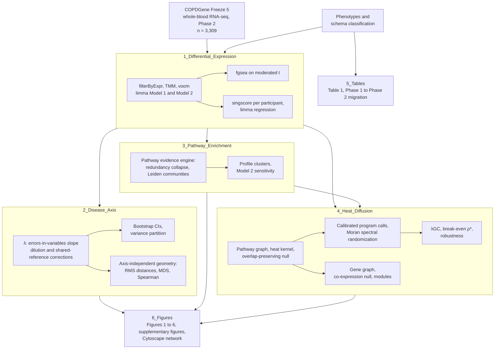

# Whole-Blood Transcriptomic Signatures Distinguish Multidimensional COPD Schema Reclassified Groups

### Whole-blood RNA-seq analysis and calibrated pathway heat diffusion in COPDGene

---

## 1. Summary

This repository holds the **R scripts** (v.4.5) and **Python scripts** (v.3.11+) behind the manuscript *"Whole-Blood Transcriptomic Signatures Distinguish Multidimensional COPD Schema Reclassified Groups"*.

The multidimensional COPD diagnostic schema (Bhatt et al., JAMA 2025) reclassifies participants based on airflow obstruction and other evidence of disease. It identifies some participants without airflow obstruction as having COPD and potentially excludes others with airflow obstruction. We examined whether these reclassified groups show corresponding differences in whole-blood gene expression. COPDGene participants were assigned to four groups:

- **No COPD**
- **Newly diagnosed COPD:** no airflow obstruction, three or more minor criteria
- **Potentially excluded:** airflow obstruction, no minor criterion
- **Established COPD**

The code covers four layers of evidence:

- **Differential expression and enrichment.** Gene-level differential expression (**limma-voom**), preranked pathway enrichment (**fgsea**) and participant-level pathway scores (**singscore**).
- **Disease axis.** Each reclassified group is placed on the established-COPD axis by a scaling coefficient **λ**, corrected for regression dilution and for the error correlation that the shared no-COPD reference induces.
- **Calibration.** Genomic-control inflation (**λ<sub>GC</sub>**) and the **break-even inter-gene correlation** separate methods that hold their size under the null from methods that do not.
- **Heat diffusion on pathway and gene graphs.** Programs of pathways and modules of genes are tested against nulls that keep gene overlap and co-expression, and maps are compared by **Moran spectral randomization**.

No participant-level data are committed. COPDGene data are available to qualified investigators through the COPDGene Study (www.copdgene.org) and dbGaP.

---

## 2. Pipeline Outline



The full methods are in the manuscript; the script descriptions below map each analysis step to its code.

**Software.** R 4.5.1 (edgeR, limma, fgsea, singscore, GSEABase, msigdbr, igraph, biobouncer, EnhancedVolcano, ggplot2, DT) and Python 3.11+ (numpy, scipy, pandas, networkx, scikit-learn, matplotlib). Seeds are fixed in each script.

---

## 3. Script Descriptions

### `1_Differential_Expression/`
- **`COPDGene_RNAseq_DE_FGSEA_Workflow.R`**: Main pipeline. Steps:
  - loading, cohort assembly, filtering, TMM and QC (library size, PCA, voom mean–variance);
  - limma-voom fits for both models and the three classifications, all contrasts;
  - fgsea.

  Writes `gene_de_<Model>_<Classification>_allresults_<date>.csv` and `gsea_..._allresults_<date>.csv`.
- **`COPDGene_singscore_Workflow.R`**: Participant-level singscore pathway scores and their limma regression. Writes `singscore_..._allresults_<date>.csv`.

### `2_Disease_Axis/`
- **`config.yml`**: Every path and parameter for this folder (group sizes, FDR, bootstrap replicates, seed).
- **`00_config.R`**: Path resolution, run log, check recorder.
- **`01_load.R`**: Loads gene-level results; recovers standard errors from confidence intervals and verifies them against the moderated t.
- **`02_scaling.R`**: The λ estimator:
  - design-implied shared-reference correlation;
  - regression-dilution correction;
  - on- and off-axis variance partition;
  - paired bootstrap, ρ sensitivity, per-gene departures and their detection power.
- **`03_enrichment.R`**: Builds the MSigDB cache (`msigdb_cache.rds`) and recomputes fgsea from the moderated t.
- **`05_reproduce.R`** / **`run_reproduction.R`**: Runs the scaling analysis and the fgsea recompute and writes tables and an analysis log. Checks against reference tables when they are present.
- **`Effect_Profile_Geometry.py`**: Pairwise RMS distances, distance ratios, classical MDS and Spearman profile correlations.
- **`Fig2_Disease_Axis_Geometry.py`**: Figure 2 (hexbin effect plots with λ and 95% CI).

### `3_Pathway_Enrichment/`
- **`Pathway_Evidence_Engine.R`**: Integrates fgsea, singscore and gene-level evidence; collapses redundant pathways; builds Leiden communities of overlap; produces the competitive-test concordance audit.
- **`Pathway_Profile_Clusters.R`**: Clusters the 263 non-redundant pathways by their standardized three-contrast NES profiles (Ward.D2, average silhouette); extracts leading-edge genes.
- **`Pathway_Enrichment_singscore_Figure.R`**: FGSEA representatives and the singscore matrix figure.
- **`Pathway_Robustness_Audit.R`**: Graph-threshold stability and rank-test concordance figure.
- **`Model2_Sensitivity.R`**: Model 1 vs Model 2 effect concordance and the λ difference.
- **`Hallmark_singscore_Extension.R`**: Optional Hallmark singscore extension, run from de-identified counts.
- **`GOATEA_Input_Preparation.R`**: Exports ranked gene lists for interactive enrichment review.
- **`HGNC_Nomenclature.R`**, **`Nomenclature_Audit.R`**: HGNC symbol validation helpers and the audit.

### `4_Heat_Diffusion/`
- **`paths.py`**: Input and output paths for every diffusion script.
- **`heat_kernel.py`**: Shared functions:
  - kNN gene-set graph, heat kernel, scale cap;
  - multiscale calls, Moran's I;
  - Moran spectral randomization agreement.
- **`calibrated_null.py`**: Shared functions:
  - overlap correlation C and its null factor;
  - overlap-preserving multiscale minimum-P calls with FDR/FWER;
  - λ<sub>GC</sub>.
- **`rds_reader.py`**: Minimal reader for the R `msigdb_cache.rds`.
- **`pathway_themes.py`**: Theme lexicon and enrichment-based labels for programs.
- **`01_Pathway_Graph_and_Diffusion.py`**: Builds the pathway graph and layout; runs a label-permutation reference analysis; produces scale sweeps and map agreement.
- **`02_Pathway_Calibrated_Programs.py`**: Overlap-preserving null; calibration on simulated overlap noise; calibrated program calls; program communities and labels.
- **`03_Gene_Network_Propagation.py`**: Gene graph; co-expression-preserving null; gene calls; planted-module power; modules; gene–pathway bridge.
- **`04_Diffusion_Robustness.py`**: Graph-construction sensitivity, shared-reference null and null smoothness.
- **`05_Calibration_BreakEven_Correlation.py`**: Break-even inter-gene correlation for every tested pathway.
- **`06_Figures_Pathway_Diffusion.py`**, **`07_Figures_Gene_Propagation.py`**, **`08_Figures_Publication.py`**: Diffusion figures (Figures 4–6, Supplementary Figures 6–9) and their publication layout.

### `5_Tables/`
- **`copdgene_phenotypes.py`**, **`multidimensional_schema.py`**, **`Table1_Phase2_Characteristics.py`**: The multidimensional schema computed from phenotype variables. The scripts:
  - validate against the published Phase 1 counts;
  - classify participants at Phase 2;
  - tabulate Phase 1 → Phase 2 migration;
  - build Table 1.

  The analysis scripts write the other manuscript tables: the disease-axis tables come from `2_Disease_Axis/run_reproduction.R`, and the calibration, program, break-even, robustness and gene-module tables from `4_Heat_Diffusion/02_` to `05_`.

### `6_Figures/`
- **`nature_style.py`**: Shared figure style (fonts, sizes, palette), imported by the Python figure scripts here and in `4_Heat_Diffusion/`.
- **`Fig1_Schema_Cohort.py`**: Figure 1 (schema cross-classification and cohort flow).
- **`Fig2_Axis_Volcano_Combined.py`**: Combined axis-geometry and volcano figure, assembled from `2_Disease_Axis/Fig2_Disease_Axis_Geometry.py` and `Fig3_Volcano_Plots.py` without refitting.
- **`Fig3_Volcano_Plots.R`**, **`Fig3_Volcano_Plots.py`**: Figure 3 (three-contrast volcano plots).
- **`Pathway_Cluster_Figure.py`**: Pathway-profile cluster figure.
- **`Cytoscape_Network_Export.py`**, **`Cytoscape_Render.py`**: Pathway-overlap network export and CyREST rendering.

---

## 4. Usage

1. **Obtain data access.** Request COPDGene phenotype and Freeze 5 RNA-seq data through the COPDGene Study and dbGaP, along with the de-identified schema classification files.
2. **Install packages.**
   - **R:** `data.table`, `edgeR`, `limma`, `fgsea`, `msigdbr`, `singscore`, `GSEABase`, `AnnotationHub`, `ensembldb`, `igraph`, `ComplexHeatmap`, `circlize`, `ggplot2`, `ggrepel`, `patchwork`, `hexbin`, `matrixStats`, `org.Hs.eg.db`, `yaml`, `jsonlite`, `dplyr`, `DT`, `biobouncer`.
   - **Python:** `numpy`, `scipy`, `pandas`, `networkx`, `scikit-learn`, `matplotlib`.
3. **Edit paths.** Each script opens with a path block: `DATA_DIR`/`RES_DIR` in the R workflows, `2_Disease_Axis/config.yml`, `4_Heat_Diffusion/paths.py`, and the `path/to/` entries elsewhere. Point them at your file system.
   The path blocks keep the file names of the original analysis. They correspond to these outputs:

   | File named in path blocks | Produced by |
   |---|---|
   | `gene_de_<Model>_<Classification>_allresults_*.csv` | `1_Differential_Expression/COPDGene_RNAseq_DE_FGSEA_Workflow.R` |
   | `gsea_<Model>_<Classification>_allresults_*.csv`; `fgsea_differential_all.csv` (all models, classifications and contrasts stacked, with `Model` and `Classification` columns) | `1_Differential_Expression/COPDGene_RNAseq_DE_FGSEA_Workflow.R` |
   | `singscore_<Model>_<Classification>_allresults_*.csv` | `1_Differential_Expression/COPDGene_singscore_Workflow.R` |
   | `fgsea_recomputed_<Model>_<Classification>.csv`, `msigdb_cache.rds`, `bootstrap_lambda.csv` | `2_Disease_Axis/run_reproduction.R` |
   | `pathway_integrated_evidence_model1.csv`, `igraph_pathway_clusters_model1.csv` | `3_Pathway_Enrichment/Pathway_Evidence_Engine.R` |
   | `partition_groups_*.csv` (counts of airflow obstruction by schema group) | cross-tabulation of the de-identified classification file with post-bronchodilator spirometry |

4. **Run in order:**
   ```
   Rscript 1_Differential_Expression/COPDGene_RNAseq_DE_FGSEA_Workflow.R
   Rscript 1_Differential_Expression/COPDGene_singscore_Workflow.R
   Rscript 2_Disease_Axis/run_reproduction.R
   python  2_Disease_Axis/Effect_Profile_Geometry.py
   Rscript 3_Pathway_Enrichment/Pathway_Evidence_Engine.R
   Rscript 3_Pathway_Enrichment/Pathway_Profile_Clusters.R
   Rscript 3_Pathway_Enrichment/Model2_Sensitivity.R
   python  4_Heat_Diffusion/01_Pathway_Graph_and_Diffusion.py      # ~5 min
   python  4_Heat_Diffusion/02_Pathway_Calibrated_Programs.py
   python  4_Heat_Diffusion/03_Gene_Network_Propagation.py
   python  4_Heat_Diffusion/04_Diffusion_Robustness.py
   python  4_Heat_Diffusion/05_Calibration_BreakEven_Correlation.py
   python  4_Heat_Diffusion/06_Figures_Pathway_Diffusion.py
   python  4_Heat_Diffusion/07_Figures_Gene_Propagation.py
   python  5_Tables/Table1_Phase2_Characteristics.py
   ```
   The figure scripts in `2_`, `3_`, `4_` and `6_Figures/` run after the analyses they plot. Seeds are fixed in each script.

---

## 5. References & Tools

**Cohort and diagnostic schema**
- Bhatt SP, Abadi E, Anzueto A, et al. A multidimensional diagnostic approach for chronic obstructive pulmonary disease. *JAMA*. 2025;333(24):2164–2175. [doi:10.1001/jama.2025.7358](https://doi.org/10.1001/jama.2025.7358)
- Regan EA, Hokanson JE, Murphy JR, et al. Genetic epidemiology of COPD (COPDGene) study design. *COPD*. 2010;7(1):32–43. [doi:10.3109/15412550903499522](https://doi.org/10.3109/15412550903499522)

**Differential expression**
- Robinson MD, McCarthy DJ, Smyth GK. edgeR: a Bioconductor package for differential expression analysis of digital gene expression data. *Bioinformatics*. 2010;26(1):139–140. [doi:10.1093/bioinformatics/btp616](https://doi.org/10.1093/bioinformatics/btp616)
- Robinson MD, Oshlack A. A scaling normalization method for differential expression analysis of RNA-seq data. *Genome Biol*. 2010;11(3):R25. [doi:10.1186/gb-2010-11-3-r25](https://doi.org/10.1186/gb-2010-11-3-r25)
- Law CW, Chen Y, Shi W, Smyth GK. voom: precision weights unlock linear model analysis tools for RNA-seq read counts. *Genome Biol*. 2014;15(2):R29. [doi:10.1186/gb-2014-15-2-r29](https://doi.org/10.1186/gb-2014-15-2-r29)
- Ritchie ME, Phipson B, Wu D, et al. limma powers differential expression analyses for RNA-sequencing and microarray studies. *Nucleic Acids Res*. 2015;43(7):e47. [doi:10.1093/nar/gkv007](https://doi.org/10.1093/nar/gkv007)

**Pathway enrichment and participant-level scores**
- Subramanian A, Tamayo P, Mootha VK, et al. Gene set enrichment analysis: a knowledge-based approach for interpreting genome-wide expression profiles. *Proc Natl Acad Sci USA*. 2005;102(43):15545–15550. [doi:10.1073/pnas.0506580102](https://doi.org/10.1073/pnas.0506580102)
- Korotkevich G, Sukhov V, Budin N, et al. Fast gene set enrichment analysis. *bioRxiv*. 2021:060012. [doi:10.1101/060012](https://doi.org/10.1101/060012)
- Foroutan M, Bhuva DD, Lyu R, et al. Single sample scoring of molecular phenotypes. *BMC Bioinformatics*. 2018;19(1):404. [doi:10.1186/s12859-018-2435-4](https://doi.org/10.1186/s12859-018-2435-4)
- Liberzon A, Birger C, Thorvaldsdóttir H, et al. The Molecular Signatures Database (MSigDB) hallmark gene set collection. *Cell Syst*. 2015;1(6):417–425. [doi:10.1016/j.cels.2015.12.004](https://doi.org/10.1016/j.cels.2015.12.004)
- Traag VA, Waltman L, van Eck NJ. From Louvain to Leiden: guaranteeing well-connected communities. *Sci Rep*. 2019;9(1):5233. [doi:10.1038/s41598-019-41695-z](https://doi.org/10.1038/s41598-019-41695-z)

**Calibration**
- Devlin B, Roeder K. Genomic control for association studies. *Biometrics*. 1999;55(4):997–1004. [doi:10.1111/j.0006-341x.1999.00997.x](https://doi.org/10.1111/j.0006-341x.1999.00997.x)
- Wu D, Smyth GK. Camera: a competitive gene set test accounting for inter-gene correlation. *Nucleic Acids Res*. 2012;40(17):e133. [doi:10.1093/nar/gks461](https://doi.org/10.1093/nar/gks461)
- Benjamini Y, Hochberg Y. Controlling the false discovery rate: a practical and powerful approach to multiple testing. *J R Stat Soc B*. 1995;57(1):289–300.
- Westfall PH, Young SS. *Resampling-Based Multiple Testing: Examples and Methods for p-Value Adjustment*. Wiley; 1993.

**Network propagation and heat diffusion**
- Kondor RI, Lafferty J. Diffusion kernels on graphs and other discrete input spaces. In: *Proceedings of the 19th International Conference on Machine Learning (ICML)*. 2002:315–322.
- Coifman RR, Lafon S, Lee AB, et al. Geometric diffusions as a tool for harmonic analysis and structure definition of data: diffusion maps. *Proc Natl Acad Sci USA*. 2005;102(21):7426–7431. [doi:10.1073/pnas.0500334102](https://doi.org/10.1073/pnas.0500334102)
- Cowen L, Ideker T, Raphael BJ, Sharan R. Network propagation: a universal amplifier of genetic associations. *Nat Rev Genet*. 2017;18(9):551–562. [doi:10.1038/nrg.2017.38](https://doi.org/10.1038/nrg.2017.38)
- Wagner HH, Dray S. Generating spatially constrained null models for irregularly spaced data using Moran spectral randomization methods. *Methods Ecol Evol*. 2015;6(10):1169–1178.
- Vos de Wael R, Benkarim O, Paquola C, et al. BrainSpace: a toolbox for the analysis of macroscale gradients in neuroimaging and connectomics datasets. *Commun Biol*. 2020;3(1):103. [doi:10.1038/s42003-020-0794-7](https://doi.org/10.1038/s42003-020-0794-7)
- Clauset A, Newman MEJ, Moore C. Finding community structure in very large networks. *Phys Rev E*. 2004;70(6):066111.

**Network visualization**
- Shannon P, Markiel A, Ozier O, et al. Cytoscape: a software environment for integrated models of biomolecular interaction networks. *Genome Res*. 2003;13(11):2498–2504. [doi:10.1101/gr.1239303](https://doi.org/10.1101/gr.1239303)

**Software**
- R (v.4.5): [limma](https://bioconductor.org/packages/limma), [edgeR](https://bioconductor.org/packages/edgeR), [fgsea](https://bioconductor.org/packages/fgsea), [singscore](https://bioconductor.org/packages/singscore), [msigdbr](https://cran.r-project.org/package=msigdbr), [igraph](https://r.igraph.org), [ComplexHeatmap](https://bioconductor.org/packages/ComplexHeatmap), [ggplot2](https://ggplot2.tidyverse.org), biobouncer (HGNC symbol validation).
- Python (v.3.11+): [NumPy](https://numpy.org), [SciPy](https://scipy.org), [pandas](https://pandas.pydata.org), [NetworkX](https://networkx.org), [scikit-learn](https://scikit-learn.org), [Matplotlib](https://matplotlib.org).
- [Cytoscape](https://cytoscape.org) (CyREST) for the pathway-overlap network.
- Data: [COPDGene](https://www.copdgene.org) and [dbGaP](https://www.ncbi.nlm.nih.gov/gap/); gene sets from [MSigDB](https://www.gsea-msigdb.org/gsea/msigdb), [Reactome](https://reactome.org) and [KEGG](https://www.genome.jp/kegg/); symbols from [HGNC](https://www.genenames.org).

---

## 6. Authors & Contact

- **Lead author:** Stéphanie Marie Aguilera (Center for Lung Analytics and Imaging Research, University of Alabama at Birmingham)
- **Principal Investigators:**
  - Surya P. Bhatt, University of Alabama at Birmingham: sbhatt@uabmc.edu
  - Peter J. Castaldi, Channing Division of Network Medicine, Brigham and Women's Hospital: peter.castaldi@channing.harvard.edu
- **Co-authors:** Jose S. Cabrera, Adel Boueiz, Craig P. Hersh, Arie Nakhmani, Sandeep Bodduluri, Richard Casaburi, James D. Crapo, Edwin K. Silverman, for the COPDGene Investigators.
